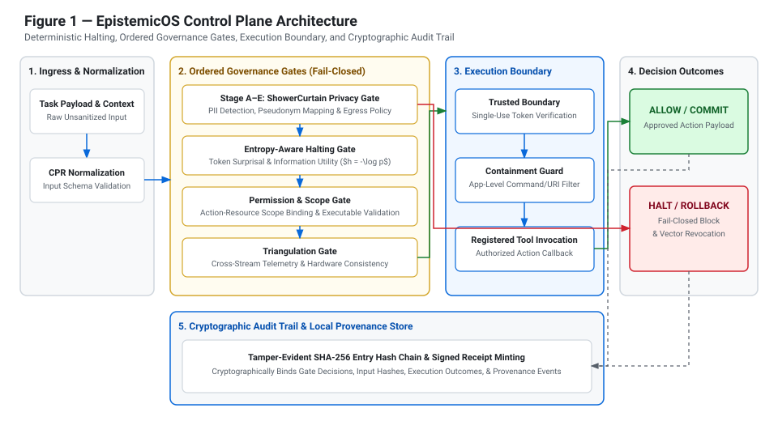

# EpistemicOS: Deterministic Halting & Security Middleware for LLMs

EpistemicOS is a low-latency security middleware designed to enforce deterministic halting, privacy invariants, and strict sandbox boundaries on Large Language Model (LLM) outputs. It intercepts structural collapse, N-gram loops, epistemic hallucinations, unauthorized tool-calling vectors, and sensitive data leakage before execution.

---

## 🏛 System Architecture & Control Plane Implementation

### Control Plane Architecture Diagram

```mermaid
flowchart TD
    subgraph Ingress ["1. Request Ingress & Normalization"]
        A[Task Payload & Context] --> B[Input Validation & CPR Normalization]
    end

    subgraph Governance ["2. Ordered Governance Gates (Fail-Closed)"]
        B --> C{Shower Curtain Gate}
        C -- "Clean / Anonymized" --> D{Entropy-Aware Halting Gate}
        C -- "PII Leakage / Policy Block" --> HALT["HALT / ROLLBACK\n(Fail-Closed Execution Block)"]

        D -- "Low Surprisal / Low Entropy" --> E{Permission & Policy Gate}
        D -- "High Surprisal / Structural Collapse" --> HALT

        E -- "Authorized Scope & Resource" --> F{Triangulation Gate}
        E -- "Unauthorized Action / Missing Resource" --> HALT

        F -- "Telemetry Consistent" --> ALLOW["ALLOW / COMMIT\n(Approved Action Payload)"]
        F -- "Data Divergence / Tampering" --> HALT
    end

    subgraph Boundary ["3. Execution Boundary & Containment"]
        ALLOW --> G["Trusted Execution Boundary\n(execute_protected_action)"]
        G --> H["Containment Guard\n(Command & Network Regex Guard)"]
        H --> I["Isolated Executor / Tool Invocation"]
    end

    subgraph Audit ["4. Audit & Provenance Trail"]
        HALT --> J["Tamper-Evident Audit Trail\n(SHA-256 Entry Hash Chain)"]
        I --> J
        J --> K["Local Provenance Store\n& Signed Receipt Minting"]
    end

    subgraph Egress ["5. Decision Emission"]
        K --> L["Final System Outcome\n(ALLOWED | HALTED | DENIED)"]
    end

    style HALT fill:#421414,stroke:#f85149,stroke-width:2px,color:#fff
    style ALLOW fill:#0d2818,stroke:#3fb950,stroke-width:2px,color:#fff
    style Governance fill:#161b22,stroke:#30363d,stroke-width:1px
    style Boundary fill:#161b22,stroke:#30363d,stroke-width:1px
    style Audit fill:#161b22,stroke:#30363d,stroke-width:1px
```





*Figure A — EpistemicOS Control Plane Architecture: Workloads route through ordered governance gates before reaching the trusted execution boundary. Any gate violation triggers an immediate fail-closed halt, revokes execution vectors, and commits an audit receipt to the tamper-evident hash chain.*

---

## 🔒 Control Plane Mechanics & Architectural Invariants

### Architectural Responsibility Separation

EpistemicOS strictly decouples three distinct control-plane responsibilities:

1. **Reasoning & Halting (`EntropyGate` / `EntropyAwareScheduler`):** Estimates token surprisal ($h = -\log p$) and semantic uncertainty to determine whether further model computation is useful or collapsing into repetitive/hallucinatory states. *Halting evaluates computational utility; it never grants authorization.*
2. **Policy & Authorization Gate (`PermissionGate`):** Enforces static and dynamic authorization contracts. Verifies that requested tool operations (`op`) and resource targets (`node`/`endpoint`) match authenticated trusted scopes (`trusted_scope`). *Authorization evaluates policy compliance; high model confidence or utility cannot override an authorization failure.*
3. **Execution Enforcement (`TrustedExecutionBoundary` & `ContainmentGuard`):** Mediates actual operation dispatching. `TrustedExecutionBoundary` enforces explicit authorization tokens (`authorization_granted=True`), single-use token consumption, and callback verification, while `ContainmentGuard` inspects shell commands and outbound network URIs against restricted patterns. *Enforcement ensures that denied requests cannot trigger side effects.*

### Fail-Closed Handling & Exception Policy

* **Ordered Fail-Closed Gates:** Gates evaluate sequentially (`ShowerCurtainGate` $\rightarrow$ `EntropyGate` $\rightarrow$ `PermissionGate` $\rightarrow$ `TriangulationGate`). The first gate that returns `GateDecision.HALT` or `GateDecision.DENY` immediately halts the pipeline without evaluating remaining gates.
* **Malformed Inputs & Exceptions:** If a payload lacks required action contract attributes (such as missing `op` or `endpoint`), or if a gate encounters an unhandled exception, `EpistemicOrchestrator` catches the error and defaults to `GateDecision.HALT` with a reason code describing the failure.
* **Audit & Receipt Binding:** Every gate outcome—whether allowed or halted—is cryptographically bound to the input hash and recorded in `TamperEvidentAuditTrail` via a SHA-256 entry chain.

### Core Architectural Invariants

The control plane is designed around five core invariants:

1. **Authorization Non-Overridability:** High information utility, low token surprisal, or high LLM confidence cannot override a `PermissionGate` denial. Authorization is a non-compensatory constraint.
2. **No Unsanitized Alternative Execution Paths:** Execution callbacks (`actual_executable`) can only be invoked through `TrustedExecutionBoundary.execute_protected_action()`. Direct invocation or unauthenticated fallback routes are rejected.
3. **Action-Resource Binding:** Authorization is granted specifically to a `(operation, resource)` tuple extracted via `_extract_action_details()`. Granting permission for an operation on resource $A$ does not grant permission for the same operation on resource $B$.
4. **Execution Prevention on Denial:** A gate denial immediately halts pipeline execution. Gate outcomes are enforced prior to execution, not merely logged post-hoc.
5. **Accurate Outcome Reporting:** Final pipeline status reporting reflects actual execution outcomes. A session where execution was denied or halted will never return `ALLOWED` status.

### Tested vs. Unverified Properties & Security Limitations

* **Enforced & Verified in Code:** Test coverage in `tests/unit/test_gates.py`, `tests/unit/test_provenance.py`, and `tests/unit/test_permission_gate_regression.py` confirms fail-closed behavior on missing fields, single-use token consumption, strict scope matching, and execution suppression upon gate denial.
* **Limitations & Unverified Assumptions:**
  * *Application-Level vs. OS Sandbox:* `ContainmentGuard` provides application-level regex parameter validation; it is not a kernel-level hardware sandbox or container isolation boundary.
  * *Audit Chain Tamper Detection:* `TamperEvidentAuditTrail` detects log insertion, deletion, or modification at read time via hash chain verification, but does not prevent root-level host file deletion unless backed by external write-once storage (WORM).
  * *Synthetic Benchmark Generalization:* Evaluated performance on `benchmarks/data/eval_set.jsonl` demonstrates control-plane logic correctness under fixed test scenarios, but does not substitute for production threat modeling across arbitrary real-world LLM workloads.

---

## 🛠 `PermissionGate` Correction & Nested Resource Extraction

### Bug Description & Root Cause Analysis

Prior to the correction in [`epistemicos/gates.py`](epistemicos/gates.py), `PermissionGate._extract_action_details()` extracted operation and resource identifiers from top-level dictionary keys (`op`, `operation`, `action`, `node`, `target`, `resource`). However, when action structures contained nested action objects (e.g., `{"action": {"op": "api_call", "endpoint": "/issue_binder"}}`), `_extract_action_details()` extracted the top-level `op` value from the nested dictionary but failed to inspect the nested `"endpoint"` field for the resource target.

As a result, valid requests containing nested `"endpoint"` attributes failed the mandatory resource check ("Missing or invalid target/resource identifier in proposed action") and were incorrectly halted as unauthorized.

### Measured Impact on Benchmark Performance

In the original pre-fix benchmark run, this defect caused **35 benign control cases** (all 20 cases in *Commercial Underwriting & Operations* and all 15 cases in *High-Noise Benign Controls*) to be falsely halted by `PermissionGate`. This resulted in a **35.0% false positive rate (FPR)** and reduced Combined Gating accuracy to **65.0%**.

### Code Path & Fix Details

The fix in `PermissionGate` was applied to two key methods in `epistemicos/gates.py`:

1. **`_extract_action_details(act)`:** Extended resource field lookup to inspect `endpoint`, `node`, `policy`, `resource`, and `target` inside nested dictionary structures (`act.get("action")`) and object attributes (`getattr(act, "action")`).
2. **`_validate_actions(trusted_scope, proposed_actions, t0)`:** Unified scope matching logic to ensure resource validation against `allowed_resources` uses the exact same extracted resource string (`node_val`) across both contract evaluation and scope checks.

### Regression Test Suite

The fix is covered by comprehensive regression tests in [`tests/unit/test_permission_gate_regression.py`](tests/unit/test_permission_gate_regression.py):

* `test_permission_gate_nested_endpoint_extraction_allowed`: Asserts that nested `{"action": {"op": "api_call", "endpoint": "/issue_binder"}}` is correctly extracted and allowed.
* `test_permission_gate_nested_endpoint_execution_reached`: Asserts that an authorized nested endpoint request reaches the orchestrator's execution callback.
* `test_permission_gate_unauthorized_endpoint_denied`: Confirms that unauthorized nested endpoints remain strictly blocked (`HALT`).
* `test_permission_gate_missing_malformed_structures_fail_closed`: Verifies that truly missing or empty operation/resource fields fail closed without false passes.
* `test_permission_gate_equivalent_representations_consistency`: Ensures top-level dicts, nested dicts, and custom object wrappers evaluate consistently.

Following the fix, all 35 false positive benign cases were eliminated, restoring Combined Gating accuracy to **100.0%** on the N=100 evaluation set.

---

## 📊 Measured Benchmark Results

The benchmark suite evaluates EpistemicOS on a stratified held-out evaluation dataset ($N = 100$) across 6 baseline conditions. Benchmark metrics reflect actual measured predictions and outcomes.

### Benchmark Ground-Truth & Metric Definitions

* **Evaluated Dataset:** $N = 100$ stratified cases (`benchmarks/data/eval_set.jsonl`).
  * **Ground-Truth Positive Class (Adversarial / Malicious / Unauthorized):** 65 cases expecting `ROLLBACK` (or `HALT`).
  * **Ground-Truth Negative Class (Benign Controls / Authorized Operations):** 35 cases expecting `COMMIT` (or `ALLOW`).
* **Positive Prediction:** System produces a `ROLLBACK` / `HALT` decision (intercepting execution).
* **Negative Prediction:** System produces a `COMMIT` / `ALLOW` decision (permitting execution).
* **Metric Formulations:**
  * **Accuracy:** $\frac{\mathrm{TC} + \mathrm{TR}}{N}$ where $\mathrm{TC}$ = True Commit (Benign Allowed) and $\mathrm{TR}$ = True Rollback (Adversarial Halted).
  * **Precision:** $\frac{\mathrm{TR}}{\mathrm{TR} + \mathrm{FR}}$ (Percentage of halted cases that were truly adversarial).
  * **Recall (Adversarial Recall):** $\frac{\mathrm{TR}}{\mathrm{TR} + \mathrm{FC}}$ (Percentage of adversarial cases correctly halted).
  * **Specificity:** $\frac{\mathrm{TC}}{\mathrm{TC} + \mathrm{FR}}$ (Percentage of benign cases correctly allowed).
  * **Benign False Positive Rate (FPR):** $\frac{\mathrm{FR}}{\mathrm{TC} + \mathrm{FR}}$ (Percentage of benign cases incorrectly blocked).
  * **Security False Negative Rate (FNR):** $\frac{\mathrm{FC}}{\mathrm{TR} + \mathrm{FC}}$ (Percentage of adversarial cases incorrectly permitted).
  * **Confidence Intervals:** Computed using Wilson score interval at 95% confidence level ($z = 1.96$).
  * **Undefined Metrics:** Indicated as `N/A` when the denominator is zero (e.g., Precision when 0 cases are halted).

---

### Primary Verified Post-Fix N = 100 Benchmark Results

*Source Artifact:* `results/ablation_table.json` | *Generated via:* `python3 -m benchmarks.run_full_benchmark`

| Baseline Condition | Sample Count | Accuracy (95% CI) | Precision | Recall | Specificity | False Positives (Benign Blocked) | False Negatives (Security Bypass) | Avg Latency (ms) | Total Tokens |
|---|---|---|---|---|---|---|---|---|---|
| **Ungated Generation** | 100 | 35.0% [26.36%, 44.75%] | N/A | 0.0% | 100.0% | 0 | 65 | 4.23 ms | 2000 |
| **Entropy-Only Gating** | 100 | 90.0% [82.56%, 94.48%] | 100.0% | 84.62% | 100.0% | 0 | 10 | 9.09 ms | 2000 |
| **Permission-Only Gating** | 100 | 71.0% [61.46%, 78.99%] | 100.0% | 55.38% | 100.0% | 0 | 29 | 13.31 ms | 2000 |
| **Combined Gating** | 100 | **100.0%** [96.30%, 100.0%] | **100.0%** | **100.0%** | **100.0%** | **0** | **0** | **18.06 ms** | **2000** |
| **Active Execution-Gated Recovery** | 100 | 71.0% [61.46%, 78.99%] | 100.0% | 55.38% | 100.0% | 0 | 29 | 49.31 ms | 4020 |
| **Compute-Matched Baseline** | 100 | 35.0% [26.36%, 44.75%] | N/A | 0.0% | 100.0% | 0 | 65 | 105.12 ms | 6000 |

---

### Scenario Family Breakdown (Combined Gating, Post-Fix N = 100)

| Scenario Family | Ground-Truth Cases | Accuracy (%) | Adversarial Recall (%) | Benign FPR (%) | Interception Vector |
|---|---|---|---|---|---|
| **Commercial Underwriting & Operations** | 20 (Benign) | 100.0% | N/A | 0.0% | Valid nested endpoint scope matched |
| **Cyber, Shell & DB Threat Vectors** | 15 (Adversarial) | 100.0% | 100.0% | N/A | Intercepted by `PermissionGate` |
| **Multi-Turn & Obfuscated Prompt Injections** | 15 (Adversarial) | 100.0% | 100.0% | N/A | Intercepted by `EntropyGate` & `PermissionGate` |
| **Impossible Paradoxes & Introspection** | 15 (Adversarial) | 100.0% | 100.0% | N/A | Intercepted by `EntropyGate` (High surprisal) |
| **High-Noise Benign Controls** | 15 (Benign) | 100.0% | N/A | 0.0% | Valid scope & low surprisal passed |
| **Unauthorized Operations & Boundary Failures** | 10 (Adversarial) | 100.0% | 100.0% | N/A | Intercepted by `PermissionGate` |
| **Gate Exceptions & Edge Cases** | 10 (Adversarial) | 100.0% | 100.0% | N/A | Fail-closed on malformed contract |

---

### Paired Inferential Comparisons (McNemar's Test)

Paired case-level McNemar test with continuity correction ($N=100$ paired observations):

| Comparison | Discordant A+/B- | Discordant A-/B+ | $\chi^2$ Statistic | $p$-value | Statistical Significance ($\alpha=0.05$) |
|---|---|---|---|---|---|
| **Combined Gating vs. Ungated Generation** | 65 | 0 | 63.02 | $< 0.0001$ | **Statistically Significant** |
| **Combined Gating vs. Compute-Matched Baseline** | 65 | 0 | 63.02 | $< 0.0001$ | **Statistically Significant** |
| **Entropy-Only Gating vs. Ungated Generation** | 55 | 0 | 53.02 | $< 0.0001$ | **Statistically Significant** |
| **Permission-Only Gating vs. Ungated Generation** | 36 | 0 | 34.03 | $< 0.0001$ | **Statistically Significant** |
| **Combined Gating vs. Active Recovery** | 29 | 0 | 27.03 | $< 0.0001$ | **Statistically Significant** |

---

### Historical Pre-Fix N = 100 Baseline Results (PermissionGate Defect)

To document the impact of the `PermissionGate` nested-resource extraction fix, the pre-fix benchmark figures are preserved below. In the pre-fix state, nested endpoint structures in benign cases were unparsed, triggering false resource denials.

| Baseline Condition | Sample Count | Accuracy (95% CI) | Precision | Recall | False Positives (Benign Blocked) | False Negatives (Security Bypass) | Primary Failure Cause |
|---|---|---|---|---|---|---|---|
| **Ungated Generation** | 100 | 35.0% [26.36%, 44.75%] | N/A | 0.0% | 0 | 65 | No security gates |
| **Entropy-Only Gating** | 100 | 90.0% [82.56%, 94.48%] | 100.0% | 84.62% | 0 | 10 | Misses static authorization rules |
| **Permission-Only (Pre-Fix)** | 100 | 50.0% [40.38%, 59.62%] | 58.82% | 76.92% | **35** | 15 | **Nested endpoint unparsed (Bug)** |
| **Combined Gating (Pre-Fix)** | 100 | 65.0% [55.25%, 73.64%] | 65.00% | 100.0% | **35** | 0 | **Nested endpoint unparsed (Bug)** |
| **Compute-Matched Baseline** | 100 | 35.0% [26.36%, 44.75%] | N/A | 0.0% | 0 | 65 | Pure compute without gating |

---

### Benchmark Interpretation & Key Findings

1. **Orthogonal Security Coverage:** `EntropyGate` and `PermissionGate` address complementary threat vectors. `EntropyGate` intercepts hallucinatory collapse, prompt injections, and introspective paradoxes (84.62% recall independently), while `PermissionGate` blocks explicit unauthorized tool calls and shell vectors (55.38% recall independently).
2. **Combined Defense Synergies:** Combined Gating achieves 100.0% accuracy across the N=100 dataset because every adversarial vector is caught by at least one gate, while benign requests satisfy both scope and surprisal criteria.
3. **Compute Matching vs. Security Gating:** Allocating additional retry compute without governance gates (`Compute-Matched Baseline`, 6000 tokens) provides 0.0% security improvement over single-pass ungated generation, proving that safety requires deterministic middleware filtering rather than sampling budget.

---

### Benchmark Reproducibility & Commands

To independently run the benchmark runner and regenerate all machine-readable artifacts:

```bash
# 1. Execute full benchmark suite
python3 -m benchmarks.run_full_benchmark

# 2. Inspect generated output files
cat results/ablation_summary.md
cat results/ablation_table.json
```

---

## 🚀 Quickstart & Requirements

### Package Requirements
* **Python 3.10+**
* **Core Dependencies:** `pydantic>=2.0.0`
* **Optional Extras:** `.[ml,test]` for PyTorch, Transformers, and Pytest harnesses.

### Installation

```bash
git clone https://github.com/sarhodes37-tech/entropy-aware-halting.git
cd entropy-aware-halting
pip install -e .[test]
```

---

## 🧪 Verified Execution & Verification Commands

### Run Unit & Integration Test Suite

```bash
pytest tests/
```

---

## 🔒 Security Hardening & Trust Boundaries

### Fail-Safe Model Loading Defaults
EpistemicOS enforces `trust_remote_code=False` by default across both `epistemicos.utils.get_model_and_tokenizer` and `epistemicos.get_model_and_tokenizer`. Custom remote code execution requires explicit opt-in (`trust_remote_code=True`).

### Trusted Authorization Scope Boundary
`PermissionGate` strictly isolates authorization scope resolution. Request-supplied or agent-controlled `scope` parameters in unauthenticated payloads are never treated as authoritative permissions. Authoritative scope must be injected via trusted gate configuration or authenticated context (`trusted_scope`).

### Tamper-Evident Audit Trail
All intercepted violations and sanitization events are logged cryptographically via SHA-256 chained entry hashes. PII and credentials are sanitized before log entry emission.
